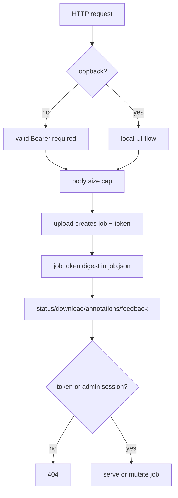

# Design: Security and Privacy Hardening

> Requirements: @requirements.md
> Status: Approved
> Last Updated: 2026-11-08

## 1. Executive Summary

Hardening добавляется поверх текущих FastAPI dependencies и локального storage без смены runtime-архитектуры. Граница доверия определяется адресом клиента: loopback сохраняет anonymous UI flow, non-loopback documents API требует valid Bearer. Каждой новой job выдаётся access token; в `job.json` хранится только digest, поэтому UUID сам по себе не является полномочием.

Входной body ограничивается на уровне ASGI receive и дополнительно в endpoint. JSON download получает отдельный лимит. Dynamic regex ограничиваются безопасной политикой без новой зависимости. Сессионная cookie получает идентификатор, который можно отозвать в process-local registry, соответствующем текущей one-process архитектуре.

## 2. Requirements Mapping

| Requirement | Design Coverage | Notes |
|-------------|-----------------|-------|
| FR-001/002 | 4, 6, TD-001 | loopback matrix and Bearer precedence |
| FR-003 | 4, 8, TD-002 | receive cap + endpoint backstop |
| FR-004 | 4, 5, TD-003 | token digest and admin bypass |
| FR-005 | 4, 5 | session jti and revocation registry |
| FR-006 | 4, TD-004 | conservative validator + loader defense |
| FR-007 | 4, 8 | configurable JSON size cap |
| FR-008 | 7 | frontend normalization |
| NFR-001..003 | 6, 8, 9 | privacy, compatibility, verification |

## 3. System Architecture

### Component Overview

| Component | Responsibility | Boundaries | Notes |
|-----------|----------------|------------|-------|
| `require_documents_auth` | loopback/Bearer decision | API dependency | invalid Bearer always fails |
| `MaxBodySizeMiddleware` | cap incoming ASGI body | all unsafe requests | counts chunks, not only Content-Length |
| `JobAccess` helpers | issue/check token digest | jobs API/storage | token never persisted in clear |
| session registry | revoke session jti | auth/session.py | process-local, one-process MVP |
| dynamic-rule validator | reject unsafe regex | admin/privacy rules | static built-ins unaffected |

### Data / Control Flow



## 4. Implementation Design

### Component / Module Structure

```text
backend/neironir/
  auth/dependencies.py       # loopback and job/auth guards
  auth/max_body_size.py      # receive-level cap
  auth/session.py             # jti + revoke registry
  api/jobs.py                # issue/check token, bounded JSON response
  domain/job.py               # optional owner/access digest fields
  storage/local.py            # atomic metadata remains compatible
  api/rules.py                # admission validation
  privacy/rules.py            # defensive loader and detector handling
frontend/app.js              # job token request header
frontend/admin.js            # span normalization
```

### Core Interfaces

- `is_loopback_client(request) -> bool`: accept IPv4/IPv6 loopback only; if client address is missing, treat as non-loopback.
- `require_documents_auth(request, settings)`: preserve invalid-Bearer precedence; no-header is allowed only for loopback.
- `issue_job_access_token() -> (raw_token, digest)`: cryptographically random token; raw token returned only in upload response.
- `verify_job_access(job, request)`: admin session bypass; otherwise constant-time digest comparison with `X-Job-Token`.
- `validate_dynamic_pattern(pattern)`: return structured rejection reason; enforce max length and reject known catastrophic constructs/backreferences.

### Data Model / State

- Extend `Job` with nullable `access_token_digest` (and optional principal marker only if needed for diagnostics). Existing jobs deserialize with `None`.
- `JobResponse` includes `access_token` only on creation response; status/download responses never echo it.
- Session payload includes random `jti`; process-local revoked-jti set is bounded by session expiry and periodically pruned.
- New settings: `json_download_max_size` (default 5 MiB), `dynamic_rule_max_length` (default 200), optional `require_job_token` default true for new jobs. Existing jobs do not receive fabricated tokens.

### API / Integration Contract

| Method / Event | Path / Topic | Purpose | Request | Response / Result |
|----------------|--------------|---------|---------|-------------------|
| POST | `/api/v1/documents/` | create job | multipart; loopback or Bearer | 202 + one-time `access_token` |
| GET | `/api/v1/documents/{id}` | status | `X-Job-Token` or admin cookie | 200 / 404 |
| GET | `/download` | result | token/admin; optional `Accept: application/json` | binary, JSON, or 404/409/413 |
| GET | `/annotations` | source annotations | token/admin | 200 / 404 |
| POST | `/feedback`, `/apply-feedback` | mutate job | token/admin + existing CSRF where applicable | existing response codes |
| POST | `/logout` | revoke session | session + CSRF | redirect |

## 5. Integration Points

| System | Purpose | Auth / Permissions | Failure Handling |
|--------|---------|--------------------|--------------------|
| FastAPI/Starlette | request parsing | middleware + dependencies | 401/413 before artifact creation |
| Local FS | job metadata/result | token digest only | atomic writes; no clear token |
| Frontend fetch | follow-up job calls | `X-Job-Token` header | clear expired/invalid-job error |
| Dynamic detector | apply regex rules | validated rules only | skip unsafe persisted rules + warning |

## 6. Security / Permissions / Privacy

- **Authentication:** valid Bearer for non-loopback; local anonymous compatibility only on loopback; admin cookie remains privileged.
- **Authorization:** every new job endpoint requires its job token or admin session; invalid access returns 404.
- **Input validation:** receive counter, file cap, JSON response cap, regex length/complexity validator, Pydantic validation retained.
- **Sensitive data:** only token digests and session jti metadata are persisted; no access token, full source, or replacement map in logs.
- **Abuse cases:** chunked upload, invalid Bearer fallback, UUID harvesting, oversized base64 response, catastrophic regex, replayed logout cookie.

## 7. UX / Accessibility

- No visible change for loopback upload/review/download.
- If job token is missing/expired, show a clear re-upload message; do not expose whether the UUID exists.
- JSON download 413 message names binary download as alternative.
- Corrupt spans are clamped/dropped; text remains escaped and visible.

## 8. Edge Cases

| Case | Expected Behavior |
|------|-------------------|
| `request.client` missing | treat as non-loopback; require Bearer |
| `X-Forwarded-For` supplied | do not trust it for loopback decision in MVP |
| invalid Bearer on loopback | 401, no anonymous fallback |
| chunked body crosses cap | stop receive and 413; no job directory |
| legacy job without digest | admin only; non-admin gets 404 |
| revoked session cookie | 401 even before TTL |
| unsafe persisted regex | skip with warning; never execute |
| JSON result over cap | 413; binary path remains available |
| overlapping/out-of-range spans | normalize/drop, no exception/XSS |

## 9. Impact Analysis

| Component | Impact Type | Description and Risk | Required Action |
|-----------|-------------|----------------------|-----------------|
| auth dependencies | modified | new trust boundary | add matrix tests |
| upload middleware/API | modified | body receive behavior | preserve ordinary multipart tests |
| Job/domain/schema | modified | nullable digest and creation token | legacy deserialization tests |
| frontend app | modified | token header | browser regression tests |
| rules detector | modified | admission/loader defense | safe/unsafe pattern tests |
| docs/.env | modified | public contract/config | document deployment modes |

## 10. Development Sequencing

1. Add settings, loopback classification, auth matrix and tests.
2. Add receive-level upload cap and tests.
3. Add job token model, issue/check helpers, route coverage and frontend propagation.
4. Add session jti/revocation.
5. Add dynamic regex validator and loader defense.
6. Add JSON cap and frontend span normalization.
7. Update API/docs and run full verification.

## 11. Testing / Verification Strategy

### Unit / Component

- loopback IPv4/IPv6/unknown client matrix;
- session jti/revoke/expiry;
- token digest comparison and legacy job behavior;
- regex safe/unsafe patterns;
- span normalization with negative, out-of-range and overlapping ranges.

### Integration / API

- non-loopback no-header/invalid-header/valid-Bearer matrix;
- chunked oversized request produces 413 and no job directory;
- token required on every job-scoped route;
- JSON over limit produces 413 while binary remains successful;
- logout invalidates old cookie and new login succeeds.

### E2E / Manual

- loopback browser upload → poll → review → download;
- LAN/M2M upload with Bearer → tokenized poll/download;
- admin rules with unsafe regex rejected.

### Project Verification

- Lint: `uv run ruff check .`
- Typecheck: `uv run mypy backend/neironir`
- Test: `uv run pytest -m "not real_model"`
- Coverage: `uv run pytest --cov=backend/neironir --cov-fail-under=70`
- Release: `make test-real` before release tag.

## 12. Observability / Operations

- Log only reason/category and job ID hash where useful; never raw token or document text.
- 401/413/422 responses carry stable error codes for support and tests.
- No new telemetry or external analytics.

## 13. Migration / Rollout

- Existing job JSON remains readable with nullable digest; legacy jobs are admin-only.
- Deploy first with loopback tests and M2M clients updated to preserve token.
- No destructive storage migration. Rollback requires reverting code; new jobs with digest remain readable by admin after rollback.

## 14. Technical Decisions

### TD-001: Address-based trust boundary

- **Decision:** trust only `request.client.host` loopback values; do not infer trust from `X-Forwarded-*`.
- **Why:** fail-closed under untrusted proxy headers and preserves local UI.
- **Trade-off:** LAN browser UI without Bearer is intentionally unsupported.
- **Alternatives considered:** global auth flag (can be misconfigured), full per-user auth (out of scope).

### TD-002: Receive cap plus endpoint backstop

- **Decision:** count every ASGI body chunk and retain a bounded post-parse file read check.
- **Why:** covers forged/missing Content-Length and parser variations.
- **Trade-off:** middleware complexity and multipart error handling.
- **Alternatives considered:** Content-Length-only (insufficient), route-only read cap (parser may already consume body).

### TD-003: Digest-only job token

- **Decision:** random opaque token returned once, SHA-256 digest stored in job metadata.
- **Why:** no clear credential at rest and no multi-user schema.
- **Trade-off:** lost token requires re-upload; admin is recovery path.
- **Alternatives considered:** UUID-only (unsafe), owner field only (does not protect anonymous loopback jobs).

### TD-004: Conservative regex policy

- **Decision:** bounded pattern length plus rejection of nested quantifiers/backreferences and unsafe constructs at add/load time.
- **Why:** no external dependency and deterministic CI.
- **Trade-off:** some legitimate advanced regexes are rejected.
- **Alternatives considered:** external regex engine with timeout (stronger but dependency/behavior change), unbounded Python `re` (unsafe).

## 15. Known Risks

| Risk | Likelihood | Impact | Mitigation |
|------|------------|--------|------------|
| client address differs behind proxy | Medium | High | document trusted boundary; require Bearer by default |
| token omitted by third-party client | Medium | Medium | explicit 401/404 contract and docs |
| regex validator false positive | Medium | Medium | conservative error reason and configurable max length |
| receive middleware incompatibility | Low | High | integration tests on Python 3.11/3.12 and multipart paths |

## 16. Implementation FAQ

**Q:** Should a valid admin cookie replace a Bearer on non-loopback?
**A:** No for documents API; non-loopback is an M2M boundary and requires Bearer. Admin cookie remains privileged for admin routes and local UI.

**Q:** What happens to a job after its access token is lost?
**A:** The owner cannot recover it through the public job API; an admin can access it. This avoids storing a recoverable secret.

**Q:** Does the token become a reverse map?
**A:** No. It authorizes access to a job but does not map placeholders back to source values.

## 17. Open Questions

- None blocking for implementation; product decisions D-001..D-003 are approved by the implementation request.
